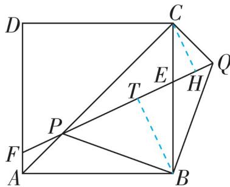

> [!success]- 必刷题
>
> > [!success] **【答案】** (1)
>
> > [!note]- **【解析】**
> > 【证明】∵线段BP绕点B顺时针旋转90°得到线段 $BQ,\therefore BP=BQ,\angle PBQ=90^{\circ}$ .∵四边形 $ABCD$ 是正方形， $\therefore BA = BC, \angle ABC = 90^{\circ}, \therefore \angle ABC = \angle PBQ, \therefore \angle ABC - \angle PBC = \angle PBQ - \angle PBC,$ 即 $\angle ABP = \angle CBQ.$ 在 $\triangle BAP$ 和 $\triangle BCQ$ 中， $\because \begin{cases} BA = BC, \\ \angle ABP = \angle CBQ, \\ BP = BQ, \end{cases}$ $\triangle BAP \cong \triangle BCQ(\mathrm{SAS}), \therefore CQ = AP.$
> >
> > (2)【解】如图, 过点 C 作 $CH \perp PQ$ 于 H, 过点 B 作 $BT \perp PQ$ 于 T.
> > ∵ $AP = \frac{1}{4} AC$ , ∴ 可设
> >
> > 
> >
> > $AP = CQ = a$ ，则 $PC = 3a.$ ∵四边形ABCD是正方形，∴ $\angle BAC = \angle ACB = 45^{\circ}$ ∴ $\triangle ABP\cong$ △CBQ,∴ $\angle BCQ = \angle BAP = 45^{\circ},\therefore \angle PCQ =$ $90^{\circ},\therefore PQ = \sqrt{PC^{2} + CQ^{2}} = \sqrt{(3a)^{2} + a^{2}} =$ $\sqrt{10} a.\because CH\bot PQ,\therefore \frac{1}{2} PC\cdot CQ = \frac{1}{2} PQ\cdot CH,$ ∴ $CH = \frac{PC\cdot CQ}{PQ} = \frac{3\sqrt{10}}{10} a.$ ∵ $BP = BQ,BT\bot$ $PQ,\therefore PT = TQ.$ ∵ $\angle PBQ = 90^{\circ},\therefore BT = \frac{1}{2} PQ =$ $\frac{\sqrt{10}}{2} a.$ ∵ $CH / / BT,\therefore$ 易证△CHE∽△BTE，
> > ∴ $\frac{CE}{EB} = \frac{CH}{BT} = \frac{\frac{3\sqrt{10}}{10}a}{\frac{\sqrt{10}}{2}a} = \frac{3}{5},\therefore \frac{CE}{CB} = \frac{3}{8}.$
> >
> > 思路分析
> > (2) 过点 C 作 $CH \perp PQ$ 于
> > H, 过点 B 作 $BT \perp PQ$ 于 T.
> > 由 $AP=\frac{1}{4}AC$ ,
> > 可设 AP =
> > CQ = a，则
> > PC = 3a，进而
> > 求出 CH, BT,
> > 利用相似三角形对应边成比例求解即可.
