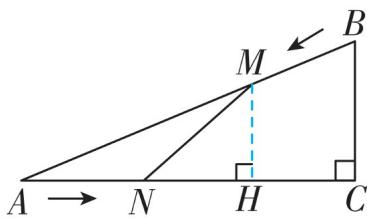

> [!success]- 必刷题
>
> > [!success] **【答案】** 详见解析
>
> > [!note]- **【解析】**
> > 【解】(1) 在 Rt $\triangle ABC$ 中, $\angle C = 90^{\circ}$ , $BC = 5 \mathrm{~cm}, AC = 12 \mathrm{~cm}$ , $\therefore AB = \sqrt{AC^{2} + BC^{2}} = \sqrt{12^{2} + 5^{2}} = 13 (\mathrm{~cm})$ .
> >
> > 易错警示
> > 注意(3)需要分类讨论, 不要漏解.
> >
> > (2)如图,作 $MH \perp AC$ 于点 H,则 $MH \parallel BC$ .
> >
> > 由题意得, $BM = 2t$ , $AN = t$ , 则 $AM = 13 - 2t$ . $\because MH \parallel BC$ , $\therefore$ 易得 $\triangle AMH \sim \triangle ABC$ ,
> >
> > 
> >
> > $\therefore \frac{MH}{BC} = \frac{AM}{AB}$ , 即 $\frac{MH}{5} = \frac{13 - 2t}{13}$ , 解得 $MH = \frac{65 - 10t}{13}$ . 由题意得, $\frac{1}{2} \times t \times \frac{65 - 10t}{13} = \frac{1}{2} \times 5 \times 12 \times \frac{3}{26}$ , 解得 $t_1 = 2, t_2 = \frac{9}{2}$ . $\therefore t$ 为 2 或 $\frac{9}{2}$ 时, $\triangle AMN$ 的面积为 $\triangle ABC$ 面积的 $\frac{3}{26}$ .
> >
> > (3)
> >
> > ## 思路分析 | 相似三角形的分类讨论
> >
> > <table><tr><td rowspan="2">以A,M,N为顶点的三角形与△ABC相似</td><td rowspan="2">∠A=∠A点A与点A对应</td><td rowspan="2">分类讨论</td><td>△ANM∼△ACB</td><td>AN/AC=AM/AB</td></tr><tr><td>△AMN∼△ACB</td><td>AN/AB=AM/AC</td></tr></table>
> >
> > 存在. $\because \angle A = \angle A, \therefore$ 当 $\triangle ANM \sim \triangle ACB$ 时, $\frac{AN}{AC} = \frac{AM}{AB}, \therefore \frac{t}{12} = \frac{13 - 2t}{13}$ , 解得 $t = \frac{156}{37}$ ; 当 $\triangle AMN \sim \triangle ACB$ 时, $\frac{AN}{AB} = \frac{AM}{AC}, \therefore \frac{t}{13} = \frac{13 - 2t}{12}$ , 解得 $t = \frac{169}{38}$ . 综上所述, 存在 $t$ 值使得以 $A, M, N$ 为顶点的三角形与 $\triangle ABC$ 相似, $t$ 的值为 $\frac{156}{37}$ 或 $\frac{169}{38}$ .
> >
> > ## 8 图形的位似
