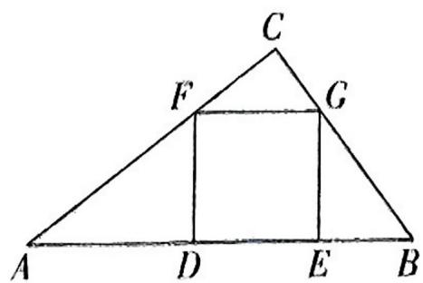
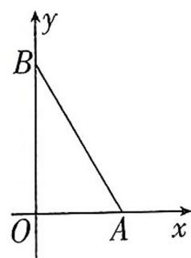
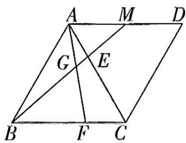

## 重难专题 2 相似三角形与其他知识的综合

直角三角形内接四边形 [2025 上海静安区校级期中, 中] 如图, 在 Rt△ABC 中, ∠C=90°, BC=6, AC=8, 四边形 DEGF 为内接正方形, 那么 AD:EB= \_\_\_\_.

![[初中/课堂同步/教辅/必刷题/2026《初中必刷题》数学北师9上/04_第四章_图形的相似/重难专题_2_相似三角形与其他知识的综合/questions/Q00108083.md]]

## 类型 1 相似三角形与函数的综合

[2024 福建厦门海沧区期末, 中] 如图, 在平面直角坐标系 $xOy$ 中, 点 $A$ 的坐标为 $(6,0)$ , $B$ 是 $y$ 轴上一点.

(1) 在线段 $AB$ 上求作点 $M$ , 使得 $\triangle AMO \sim \triangle AOB$ (要求: 尺规作图, 不写作法, 保留作图痕迹);

(2)在(1)的条件下, $AB = 4AM, OC$ 是 $\triangle AOB$ 的中线, 过点 $M$ 的直线交 $OC$ 于点 $D$ , 交 $x$ 轴于点 $F$ , 当 $MO = MF$ 时, 求点 $D$ 的坐标.

## 类型 2 相似三角形与其他图形的综合

[2025 福建三明期中, 中] 如图, 在菱形 $ABCD$ 中, $M$ 为 $AD$ 的中点, $BM$ 与 $AC$ 的交点为 $E$ , 点 $F$ 在边 $BC$ 上, $AF$ 交 $BM$ 于点 $G$ , 且 $\angle BGF = \angle ABC$ .

(1) 求证: $\triangle BAG \sim \triangle BMA$ ;

(2) 若 $\angle ABC = 60^{\circ}$ , 连接 $CG$ , 求证: $CG \perp BM$ .

建议用时 20 分钟 答案 D65

![[初中/课堂同步/教辅/必刷题/2026《初中必刷题》数学北师9上/04_第四章_图形的相似/重难专题_2_相似三角形与其他知识的综合/questions/Q00108084.md]]

## 类型 3 几何动态与相似三角形的综合

![[初中/课堂同步/教辅/必刷题/2026《初中必刷题》数学北师9上/04_第四章_图形的相似/重难专题_2_相似三角形与其他知识的综合/questions/Q00108085.md]]
