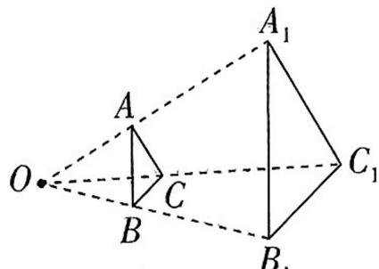

<!-- question-source:start -->
1 [2024 四川凉山州中考] 如图, 一块面积为 $60 \mathrm{~cm}^{2}$ 的三角形硬纸板 (记为 $\triangle ABC$ ) 平行于投影面时, 在点光源 $O$ 的照射下形成的投影是 $\triangle A_{1} B_{1} C_{1}$ , 若 $OB: B B_{1} = 2: 3$ , 则 $\triangle A_{1} B_{1} C_{1}$ 的面积是 ( )

A. $90 \mathrm{~cm}^{2}$

B. ${135}{\mathrm{\;{cm}}}^{2}$

C. ${150}{\mathrm{\;{cm}}}^{2}$

D. ${375}{\mathrm{\;{cm}}}^{2}$

<!-- question-source:end -->

![[Q00108162A1]]
