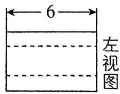

<!-- question-source:start -->
8[山东菏泽中考]如图是一个几何体的三视图,根据图中所标数据计算这个几何体的体积为( )

A. $12\pi$

B. $18 \pi$

C. ${24\pi }$

D. $30\pi$

如果执意去做一件事，就不要再问自己和别人值不值得，心甘情愿才能理所当然，理所当然才会又无反顾。
<!-- question-source:end -->

![[Q00108169A1]]
