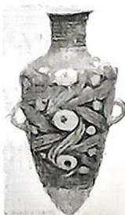

<!-- question-source:start -->
2 新考向传统文化 [2024 甘肃临夏州中考]马家窑彩陶绚丽典雅,符号丰富,被称为彩陶文化的“远古之光”.如图是一件马家窑彩陶作品的立体图形,有关其三视图说法正确的是 ( )
A. 主视图和左视图完全相同
B. 主视图和俯视图完全相同
C. 左视图和俯视图完全相同
D. 三视图各不相同

<!-- question-source:end -->

![[Q00108170A1]]
