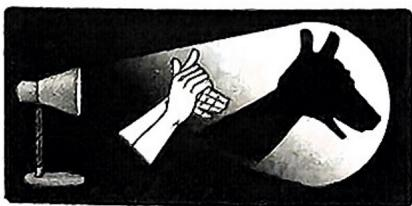
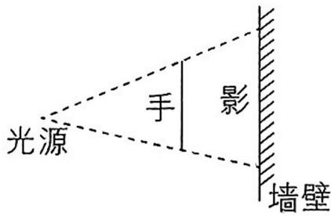

<!-- question-source:start -->
3 新考法 [2025 河北石家庄期中] 手影游戏利用的物理原理是光是沿直线传播的, 图(1)中的小狗手影就是我们小时候常玩的游戏. 在一次手影游戏中, 小明的手距离墙壁 2 米, 爸爸拿着的光源与小明的距离为 4 米, 如图(2)所示, 若在光源不动的情况下, 要使小狗手影的长度增加一倍, 则小明手与光源的距离应 ( )

图(1)

图(2)

A.增加1米 B.减少1米 C.增加2米 D.减少2米
<!-- question-source:end -->

![[Q00108171A1]]
