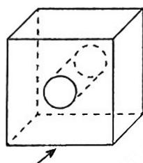

<!-- question-source:start -->
6[2025 陕西西安校级质检]如图是在一个棱长为 $3 \mathrm{~cm}$ 的正方体中间挖掉一个直径为 $1 \mathrm{~cm}$ 的圆柱形成的几何体. (1)请画出这个几何体的三视图; (2)求该几何体的表面积.

正面
“
<!-- question-source:end -->

![[Q00108174A1]]
