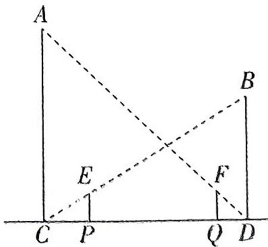

<!-- question-source:start -->
7 [2025 四川雅安期末]如图,小明在晚上站在 $P$ 处时发现,他在路灯 $BD$ 下的影长为 2 米,且影子顶部恰好位于路灯 $AC$ 的底部,接着他走了 6.5 米到 $Q$ 处,此时他在路灯 $AC$ 下的影子顶部恰好位于路灯 $BD$ 的底部(已知小明身高 1.8 米,路灯 $BD$ 高 9 米). (1)指出小明站在 $P$ 处时在路灯 $BD$ 下的影子; (2)计算小明站在 $Q$ 处时在路灯 $AC$ 下的影长; (3)计算路灯 $AC$ 的高度.

电子错题本鸭
<!-- question-source:end -->

![[Q00108175A1]]
