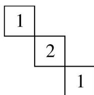

> [!success]- 必刷题
>
> > [!success] **【答案】** C
>
> > [!note]- **【解析】**
> > 由主视图和左视图可确定所需正方体个数最少时俯视图如图(数字表示该位置小正方体的个数),则组成该几何体所需小正方体的个数最少是 $1 + 2 + 1 = 4$ .
> >
> > 
> >
> > ## 关键点拨
> >
> > 分别在俯视图的相应位置上标出小立方块最少和最多时所摆放的个数是解决问题的关键.
