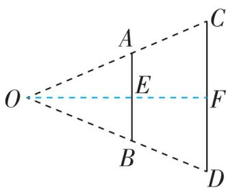
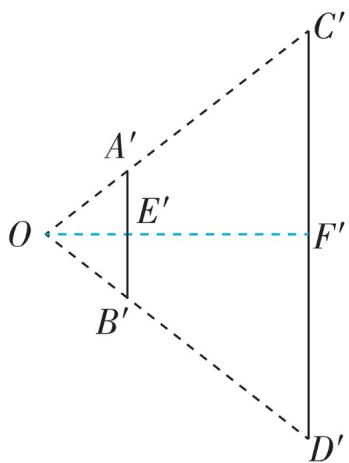

> [!success]- 必刷题
>
> > [!success] **【答案】** D
>
> > [!note]- **【解析】**
> > 如图(1), 点 O 为光源, AB 表示小明的手, CD 表示小狗手影, 则 AB // CD. 过点 O 作 OE ⊥ AB, 延长 OE 交 CD 于 F, 则 OF ⊥ CD.
> >
> > ∵ AB // CD, ∴ ∠OAB = ∠OCD, ∠OBA = ∠ODC, ∴ △AOB ∽ △COD, ∴ $\frac{AB}{CD} = \frac{OE}{OF}$ . ∵ EF = 2 米, OE = 4 米, ∴ OF = 6 米, ∴ $\frac{AB}{CD} = \frac{OE}{OF} = \frac{2}{3}$ , ∴ 设 AB = 2k, CD = 3k. ∵ 在光源不动的情况下, 要使小狗手影的长度增加一倍, 如图(2), 即 A'B' = 2k, C'D' = 6k, OF' = OF = 6 米. 同理得 △A'OB' ∽ △C'OD', ∴ $\frac{A'B'}{C'D'} = \frac{OE'}{OF'} = \frac{1}{3}$ , 则 OE' = 2 米, ∴ 小明手与光源的距离应减少 OE-OE' = 4-2 = 2 (米), 故选 D.
> >
> > 
> >
> > 
> > 图(1)
> > 图(2)
