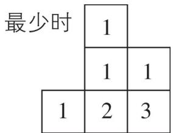
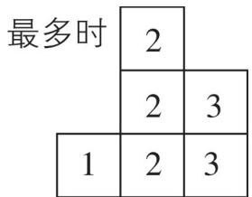

> [!success]- 必刷题
>
> > [!success] **【答案】** 22
>
> > [!note]- **【解析】**
> > 根据中心投影的概念: 从一个点发出的光线所形成的投影称为中心投影, 可以得到该投影属于中心投影.
> >
> > 5.22 【解析】根据主视图、俯视图,可以得出小立方块最少时(图中只画了其中一种情况)、最多时,在俯视图的相应位置上所摆放的个数如下:
> >
> > 
> >
> > 
> > 俯视图
> > 俯视图
> >
> > 所以最少需要小立方块9个,最多需要13个,因此n的最大值和最小值之和为 $9+13=22$ .故答案为22.
