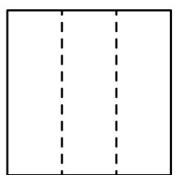

> [!success]- 必刷题
>
> > [!success] **【答案】** 详见解析
>
> > [!note]- **【解析】**
> > 【解】(1)三视图如图所示:
> >
> > 左视图
> > 
> > 俯视图
> >
> > (2)该几何体的表面积为 $3 \times 3 \times 6 - 2\pi \times$ $\left(\frac{1}{2}\right)^2 + \pi \times 1 \times 3 = \left(54 + \frac{5}{2}\pi\right)\mathrm{cm}^2.$
