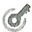
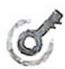

## 全章综合训练 刷中考

## 考点1 投影

![[初中/课堂同步/教辅/必刷题/2026《初中必刷题》数学北师9上/05_第五章_投影与视图/全章综合训练/questions/Q00108162.md]]

## 考点2 常见几何体的三视图

![[初中/课堂同步/教辅/必刷题/2026《初中必刷题》数学北师9上/05_第五章_投影与视图/全章综合训练/questions/Q00108163.md]]
![[初中/课堂同步/教辅/必刷题/2026《初中必刷题》数学北师9上/05_第五章_投影与视图/全章综合训练/questions/Q00108164.md]]
![[初中/课堂同步/教辅/必刷题/2026《初中必刷题》数学北师9上/05_第五章_投影与视图/全章综合训练/questions/Q00108165.md]]

## 考点 3 由三视图还原几何体及相关计算

![[初中/课堂同步/教辅/必刷题/2026《初中必刷题》数学北师9上/05_第五章_投影与视图/全章综合训练/questions/Q00108166.md]]
![[初中/课堂同步/教辅/必刷题/2026《初中必刷题》数学北师9上/05_第五章_投影与视图/全章综合训练/questions/Q00108167.md]]
![[初中/课堂同步/教辅/必刷题/2026《初中必刷题》数学北师9上/05_第五章_投影与视图/全章综合训练/questions/Q00108168.md]]

## 考点4 结合几何体的三视图进行计算

![[初中/课堂同步/教辅/必刷题/2026《初中必刷题》数学北师9上/05_第五章_投影与视图/全章综合训练/questions/Q00108169.md]]
