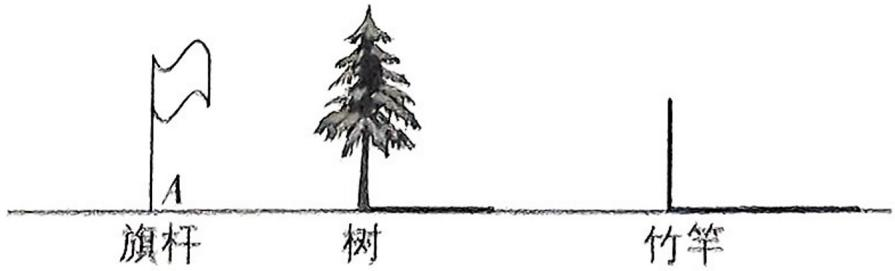

<!-- question-source:start -->
4 [2025 陕西西安校级质检]旗杆、树和竹竿都垂直于地面且一字排列,在路灯下树和竹竿的影子(粗线)如图所示.请根据图上的信息标出路灯灯泡 $P$ 的位置,再作出旗杆的影子 $AB$ . (不写作法,保留作图痕迹)

建议用时 20 分钟 答案 D71
<!-- question-source:end -->

![[Q00108120A1]]
