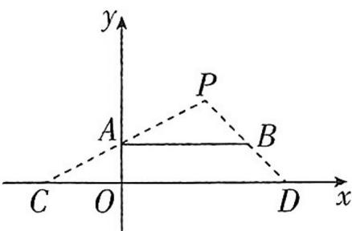
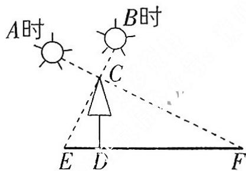

<!-- question-source:start -->
6 如图,在平面直角坐标系中,点光源位于 $P(2, 2)$ 处,木杆 $AB$ 两端的坐标分别为 $(0,1),(3,1)$ , 则木杆 $AB$ 在 $x$ 轴上的影长 $CD$ 为 \_\_\_\_.

(第6题图)
(第7题图)
<!-- question-source:end -->

![[Q00108122A1]]
