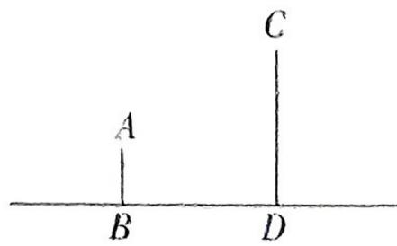

<!-- question-source:start -->
8 [2025 贵州贵阳期末] 学习完投影后, 小光同学在灯光下观察自己的影子. 如图, 线段 AB 表示站立的小光, 线段 CD 表示此时操场上的灯杆, 点 C 为路灯所在位置.

(1)画出小光在路灯 C 下的影子 BE;

(2)如果小光身高为 1.8 m, 他站在距离灯杆 CD 5 m 的 B 处(即 BD = 5 m)时, 测得自己的影长 BE 为 3 m, 求灯杆 CD 的高度.

<!-- question-source:end -->

![[Q00108124A1]]
