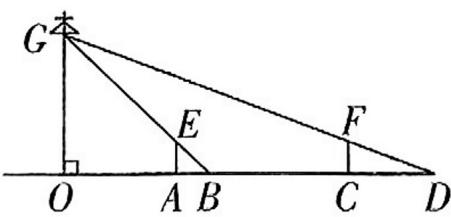

<!-- question-source:start -->
3 [2024 广西贵港期中, 中] 如图, 一路灯 $OG$ 高 5.6 米, 身高 1.6 米的小方从距离路灯的底部 (点 $O$ ) 5 米的 $A$ 处, 沿 $OA$ 所在的直线行走到点 $C$ 时, 人影长度增加 3 米, 小方行走的路程是 \_\_\_\_ 米.

<!-- question-source:end -->

![[Q00108127A1]]
