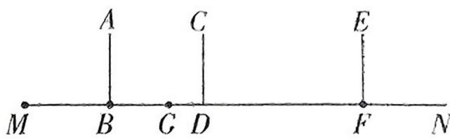

<!-- question-source:start -->
4[2024 山东东营调研, 中]如图, 小明从点 $M$ 出发以 1.5 米/秒的速度, 沿射线 $MN$ 方向匀速前进, 2 秒后到达点 $B$ , 此时他 $(AB)$ 在某一灯光下的影子为 $MB$ , 继续按原速行走 2 秒到达点 $D$ , 此时他 $(CD)$ 在同一灯光下的影子 $GD$ 仍落在其身后, 并测得这个影长为 1.2 米, 然后他将速度提高到原来的 1.5 倍, 再行走 2 秒到达点 $F$ . (1)请在图中画出光源 $O$ 点的位置, 并画出小明位于点 $F$ 时在这个灯光下的影子 $FH$ (不写画法);

(2)求小明(EF)到达点 F 时的影子 FH 的长.

<!-- question-source:end -->

![[Q00108128A1]]
