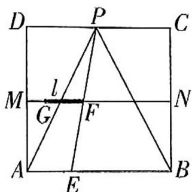
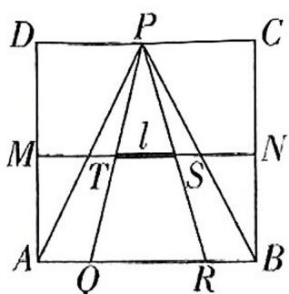
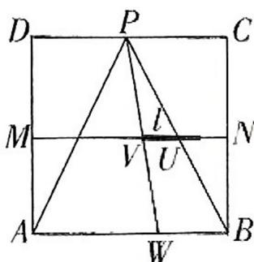

<!-- question-source:start -->
5 核心素养运算能力 [较难] 如图, 正方形 $ABCD$ 的边长为 4 , 点 $M, N, P$ 分别为 $AD, BC, CD$ 的中点. 现从点 $P$ 观察线段 $AB$ , 当长度为 1 的线段 $l$ (图中的黑粗线) 以每秒 1 个单位的速度沿线段 $MN$ 从左向右运动时, $l$ 将阻挡部分观察视线, 在 $\triangle PAB$ 区域内形成盲区. 设 $l$ 的右端点运动到 $M$ 点的时刻为 0 , 用 $t$ (秒) 表示 $l$ 的运动时间. (1) 请你针对图 (1)、图 (2)、图 (3) 中 $l$ 位于不同位置的情形, 分别画出在 $\triangle PAB$ 内相应的盲区, 并在盲区内涂上阴影. (2) 设 $\triangle PAB$ 内的盲区面积是 $y$ (平方单位), 在下列条件下, 求出用 $t$ 表示 $y$ 的函数关系式. ① $1 \leqslant t \leqslant 2$ . ② $2 \leqslant t \leqslant 3$ . ③ $3 \leqslant t \leqslant 4$ . 根据①\~③中得到的结论, 请你简单概括 $y$ 随 $t$ 变化而变化的情况.

图(1)

图(2)

图(3)

<!-- question-source:end -->

![[Q00108129A1]]
