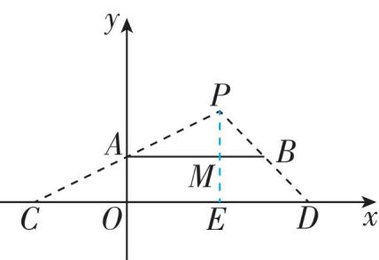

> [!success]- 必刷题
>
> > [!success] **【答案】** B
>
> > [!note]- **【解析】**
> > 晚上小亮在路灯下散步, 在小亮由 A 处径直走到 B 处这一过程中, 他在地上的影子先变短后变长. 故选 B.
> >
> > 影子的顶端和物体的顶端的连线即为一条光线，多条光线的交点即为光源的位置.
> >
> > 6.6 【解析】过 $P$ 作 $PE \perp x$ 轴于 $E$ , 交 $AB$ 于 $M$ , 如图. $\because P(2,2), A(0,1), B(3,1), \therefore PM = 1,$
> >
> > 
> >
> > $PE = 2, AB = 3.\because AB \parallel CD, \therefore \triangle PAB \sim \triangle PCD,$ $\therefore \frac{AB}{CD} = \frac{PM}{PE}$ , 即 $\frac{3}{CD} = \frac{1}{2}, \therefore CD = 6$ , 故答案为 6.
> >
> > 7.2 【解析】根据题意得 $CE \perp CF, CD = 4, FD = 8$ . $\because CE \perp CF, \therefore \angle ECF = 90^{\circ}, \therefore \angle ECD + \angle DCF = 90^{\circ}$ . $\because CD \perp EF, \therefore \angle CDE = \angle CDF = 90^{\circ}, \therefore \angle F + \angle DCF = 90^{\circ}, \therefore \angle ECD = \angle CFD,$ $\therefore Rt\triangle CDE \sim Rt\triangle FDC, \therefore \frac{ED}{CD} = \frac{CD}{FD}$ , 即 $CD^{2} = ED \cdot FD$ , 代入数据可得 $4^{2} = 8ED$ , 解得 $ED = 2$ , 即 $B$ 时的影长 $DE$ 为 $2\mathrm{m}$ . 故答案为 2.
