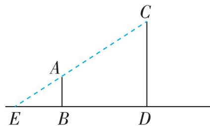

> [!success]- 必刷题
>
> > [!success] **【答案】** C
>
> > [!note]- **【解析】**
> > 【解】(1) 小光在路灯 $C$ 下的影子 $BE$ 如图所示.
> >
> > 
> >
> > 知, $AB \parallel CD$ , ∴ 易得 $\triangle EAB \sim \triangle ECD$ , ∴ $\frac{AB}{CD} = \frac{BE}{DE}$ , ∴ $\frac{1.8}{CD} = \frac{3}{3+5}$ , ∴ CD = 4.8 m.
