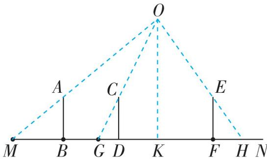

> [!success]- 必刷题
>
> > [!success] **【答案】** 详见解析
>
> > [!note]- **【解析】**
> > 【解】(1)如图,点 O 和 FH 为所作.
> >
> > 
> >
> > (2)由题意得, $BM = BD = 3$ , $GD = 1.2$ , $DF = 1.5 \times 1.5 \times 2 = 4.5$ . 设 $AB = CD = EF = a$ , 作 $OK \perp MN$ 于 $K$ , 如上图. $\because AB \parallel OK$ , $\therefore \triangle MAB \sim \triangle MOK$ , $\therefore \frac{AB}{OK} = \frac{MB}{MK}$ , 即 $\frac{a}{OK} = \frac{3}{6 + DK}$ . ① $\because CD \parallel OK$ , $\therefore \triangle GCD \sim \triangle GOK$ , $\therefore \frac{CD}{OK} = \frac{GD}{GK}$ , 即 $\frac{a}{OK} = \frac{1.2}{1.2 + DK}$ , ② 由 ① ② 得 $\frac{3}{6 + DK} = \frac{1.2}{1.2 + DK}$ , 解得 $DK = 2$ , $\therefore \frac{a}{OK} = \frac{3}{6 + 2} = \frac{3}{8}$ , $FK = DF - DK = 4.5 - 2 = 2.5$ . $\because EF \parallel OK$ , $\therefore \triangle HEF \sim \triangle HOK$ , $\therefore \frac{EF}{OK} = \frac{HF}{HK}$ , 即 $\frac{HF}{HF + 2.5} = \frac{3}{8}$ , $\therefore HF = 1.5$ . 答: 小明到达点 $F$ 时的影子 $FH$ 的长为 1.5 米.
