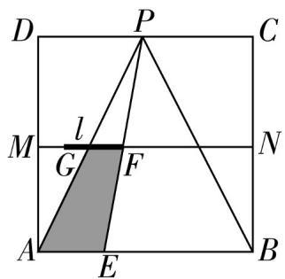
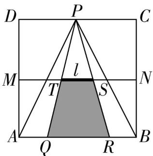
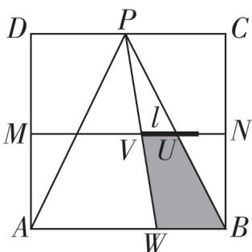

> [!success]- 必刷题
>
> > [!success] **【答案】** 详见解析
>
> > [!note]- **【解析】**
> > 【解】(1)如图：
> >
> > 
> > 图(1)
> >
> > 刷有所得太阳的位置和高度决定了影子的方向和长短. 一天中, 阳光下物体的影子变化规律是上午影子由长逐渐变短; 下午影子由短逐渐变长. 方向由西逐渐转向东.
> >
> > 本题考查的是相似三角形在中心投影中的实际应用,找出相似三角形,再利用相似三角形对应边成比例求解.
> >
> > 
> >
> > 
> > 图(2)
> > 图(3)
> >
> > ## 关键点拨
> >
> > ## 刷有所得
> >
> > 视点、视角和盲区: 把观察者所处的位置定为一点, 叫视点; 人眼到视平面的距离是固定的(视距), 视平面左右两个边缘到人眼的连线得到的角就是视角; 视线到达不了的区域为盲区.
> >
> > (2)①当 $t = 1$ 时, 不会形成盲区, 则 $y = 0$ . 当 $1 < t \leqslant 2$ 时, $\triangle PAB$ 内的盲区是梯形 $AEFG$ . $MG, FG$ 分别是 $\triangle PAD$ , $\triangle PAE$ 的中位线, $\therefore MG = \frac{1}{2} PD = 1, FG = t - 1, AE = 2(t - 1)$ . 而梯形 $AEFG$ 的高为 $2, \therefore y = \frac{1}{2} [(t - 1) + 2(t - 1)] \times 2 = 3t - 3$ . $\therefore$ 当 $1 \leqslant t \leqslant 2$ 时, $y = 3t - 3$ . ②当 $2 \leqslant t \leqslant 3$ 时, $\triangle PAB$ 内的盲区是梯形 $QRST$ . 易知 $TS = 1, QR = 2$ , 而梯形 $QRST$ 的高为 $2, \therefore y = \frac{1}{2}(1 + 2) \times 2 = 3$ . ③当 $3 \leqslant t < 4$ 时, $\triangle PAB$ 内的盲区是梯形 $WBUV$ . 易知 $UV = 1 - (t - 3) = 4 - t, WB = 2(4 - t)$ , 而梯形 $WBUV$ 的高为 $2, \therefore y = \frac{1}{2} [(4 - t) + 2(4 - t)] \times 2 = 12 - 3t$ . 当 $t = 4$ 时, 不会形成盲区, 则 $y = 0$ . $\therefore$ 当 $3 \leqslant t \leqslant 4$ 时, $y = 12 - 3t$ . 当 $1 \leqslant t \leqslant 2$ 时, 盲区的面积 $y$ 由 0 逐渐增大到 3; 当 $2 \leqslant t \leqslant 3$ 时, 盲区的面积 $y$ 为定值 3; 当 $3 \leqslant t \leqslant 4$ 时, 盲区的面积 $y$ 由 3 逐渐减小到 0.
