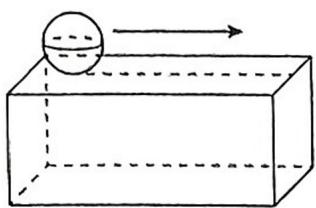
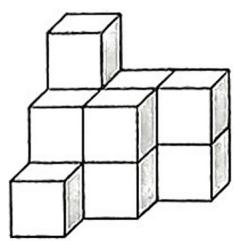

<!-- question-source:start -->
1 [2025 河北衡水调研, 中] 如图, 一个球在长方体上沿虚线从左向右滚动, 在滚动过程中, 球与长方体的组合图形的视图始终不变的是 ( )
A. 左视图
B. 主视图
C. 俯视图
D. 左视图和俯视图

(第1题图)

(第2题图)
<!-- question-source:end -->

![[Q00108142A1]]
