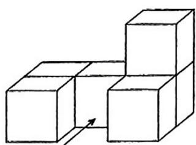

<!-- question-source:start -->
4 [2024 辽宁本溪期中, 中] 如图是由 6 个大小相同的小正方体搭建的几何体, 其中每个小正方体的棱长为 1 厘米. 如果保持俯视图和主视图不变, 再添加一些小正方体, 则添加小正方体后这个几何体的表面积 (包括底部) 为 \_\_\_\_ 平方厘米.

从正面看

<!-- question-source:end -->

![[Q00108145A1]]
