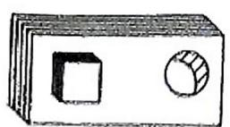
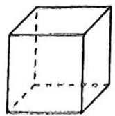
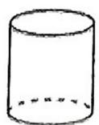
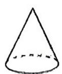
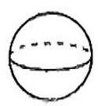

<!-- question-source:start -->
4 如图,一长方体木板上有两个洞,一个是正方形形状的,一个是圆形形状的,对于以下4种几何体,作为塞子既可以堵住圆形空洞又可以堵住正方形空洞的是\_\_\_\_(填序号).备注:圆柱与圆锥的底面直径与高相等.

①

②

③
④

建议用时-20分钟
<!-- question-source:end -->

![[Q00108291A1]]
