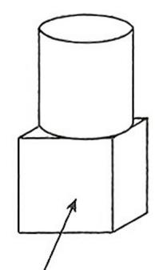
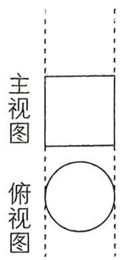
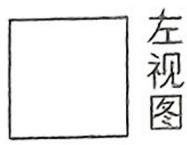

<!-- question-source:start -->
5 [2025 辽宁抚顺质检, 中]某游乐园门口需要修建一个由正方体和圆柱组合而成的立体图形, 其示意图如图(1)所示, 已知正方体的棱长与圆柱的底面直径及高相等, 都是 2 米.

(1) 图(2)是这个立体图形主视图、左视图和俯视图的一部分,请将它们补充完整;

(2)为了防腐,需要在这个立体图形表面刷一层油漆.已知油漆每平方米50元,那么一共需要花费多少元?(π取3.14)(说明:正方体一底面立于地上,不刷油漆;圆柱一底面立于正方体上,重合部分不刷油漆)

从正面看

图(1)
图(2)
<!-- question-source:end -->

![[Q00108292A1]]
