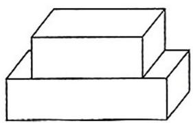
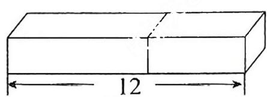
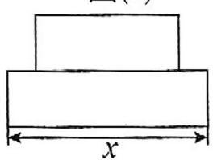
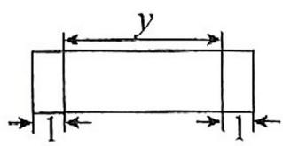
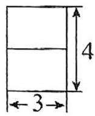

<!-- question-source:start -->
6 [较难]图(1)是由两个长方体组成的立体图形, 图(2)中的长方体是图(1)中的两个长方体的另一种摆放形式, 图①②③是从不同的方向看图(1)所得的平面图形.

图(1)

图①

图(2)

图②

图③

(1) 填空: 图①是从\_\_\_\_面看得到的平面图形, 图②是从\_\_\_\_面看得到的平面图形, 图③是从\_\_\_\_面看得到的平面图形.

(2)请根据各图中所给的信息(单位:cm),计算出图(1)中上面的小长方体的体积.
<!-- question-source:end -->

![[Q00108293A1]]
