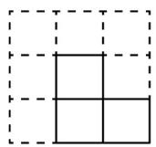
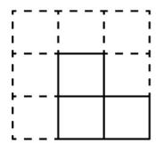
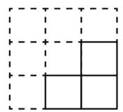
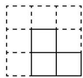
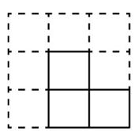
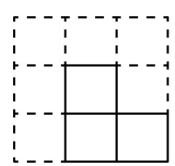
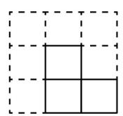
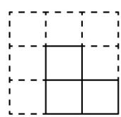

> [!success]- 必刷题
>
> > [!success] **【答案】** B
>
> > [!note]- **【解析】**
> > 选项 A、选项 B、选项 C、选项 D 中的几何体的主视图与左视图分别如下：
> >
> > 
> > 主视图
> >
> > 
> >
> > 主视图与俯视图要长对正；主视图与左视图要高平齐，左视图与俯视图要宽相等.
> >
> > 左视图
> > 
> >
> > ## 方法点拨
> >
> > 主视图
> > 
> > 左视图
> > 选项B中的几何体
> >
> > 选项A中的几何体
> > 
> >
> > 
> > 主视图
> > 左视图
> >
> > 
> > 主视图
> >
> > 
> > 选项C中的几何体
> > 左视图
> > 选项D中的几何体
> >
> > 其中主视图与左视图不同的是选项 B 中的几何体,
> >
> > 故选 **B**.
