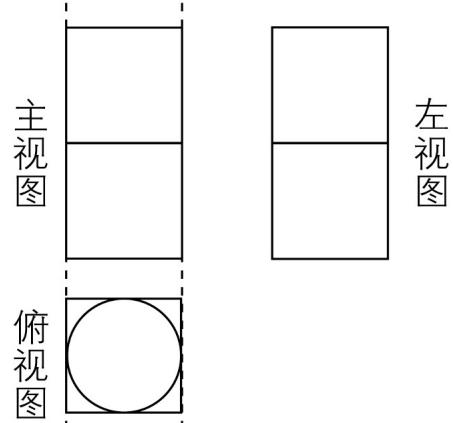
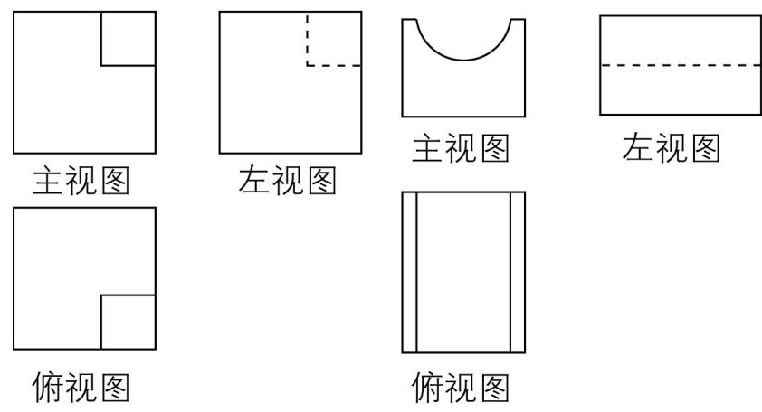

> [!success]- 必刷题
>
> > [!success] **【答案】** 详见解析
>
> > [!note]- **【解析】**
> > 【解】(1)补全三视图如图所示.
> >
> > 
> >
> > (2) $5 \times 2 \times 2 + 2 \times 2 \times \pi = 20 + 4\pi \approx 20 + 3.14 \times 4 =$ 32.56(平方米), ∴ 32.56×50=1628(元).
> > 答:一共需要花费1628元.
> >
> > 
> > 图(1)
> > 图(2)
