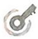
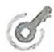

## 课时 1 认识三视图 刷基础

## 基础

## 知识点 1 简单几何体的三视图

![[初中/课堂同步/教辅/必刷题/2026《初中必刷题》数学北师9上/05_第五章_投影与视图/课时_1_认识三视图/questions/Q00108136.md]]
![[初中/课堂同步/教辅/必刷题/2026《初中必刷题》数学北师9上/05_第五章_投影与视图/课时_1_认识三视图/questions/Q00108289.md]]
![[初中/课堂同步/教辅/必刷题/2026《初中必刷题》数学北师9上/05_第五章_投影与视图/课时_1_认识三视图/questions/Q00108290.md]]
![[初中/课堂同步/教辅/必刷题/2026《初中必刷题》数学北师9上/05_第五章_投影与视图/课时_1_认识三视图/questions/Q00108291.md]]

## 知识点 2 常见组合体的三视图

![[初中/课堂同步/教辅/必刷题/2026《初中必刷题》数学北师9上/05_第五章_投影与视图/课时_1_认识三视图/questions/Q00108138.md]]
![[初中/课堂同步/教辅/必刷题/2026《初中必刷题》数学北师9上/05_第五章_投影与视图/课时_1_认识三视图/questions/Q00108139.md]]
![[初中/课堂同步/教辅/必刷题/2026《初中必刷题》数学北师9上/05_第五章_投影与视图/课时_1_认识三视图/questions/Q00108140.md]]
![[初中/课堂同步/教辅/必刷题/2026《初中必刷题》数学北师9上/05_第五章_投影与视图/课时_1_认识三视图/questions/Q00108141.md]]
