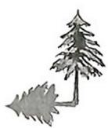
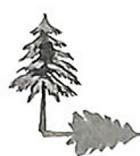

<!-- question-source:start -->
2 [2024 河北衡水调研] 如图是嘉淇在室外用手机拍下从上午到下午大树的影子随太阳位置变化的照片, 这五张照片拍摄的时间先后顺序是 ( )

①

②

③

④

⑤

A. ①②③④⑤
B. ②④①③⑤
C. ⑤④①③②
D. ⑤③①④②
<!-- question-source:end -->

![[Q00108131A1]]
