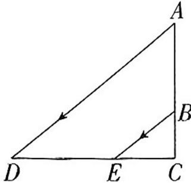

<!-- question-source:start -->
3 如图,阳光从教室的窗户射入室内,窗户框AB在地面上的影长DE=1.8m,窗户下檐到地面的距离BC=1m,

$EC = 1.2 \mathrm{~m}$ , 那么窗户的高 $AB$ 为 ( )
A. $1.5 \mathrm{~m}$ B. $1.6 \mathrm{~m}$ C. $1.86 \mathrm{~m}$ D. $2.16 \mathrm{~m}$
<!-- question-source:end -->

![[Q00108132A1]]
