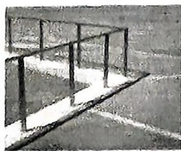
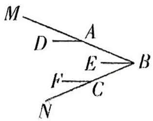

<!-- question-source:start -->
4 [2025 浙江杭州质检]某一时刻在阳光照射下, 广场上的护栏及其影子如图(1)所示, 将护栏拐角处在地面上的部分影子抽象成图(2), 已知 $\angle MAD = 22^{\circ}$ , $\angle FCN = 23^{\circ}$ , 则 $\angle ABC$ 的大小为 ( )

图(1)

图(2)

A. $44^{\circ}$ B. $45^{\circ}$ C. $46^{\circ}$ D. $47^{\circ}$
<!-- question-source:end -->

![[Q00108133A1]]
