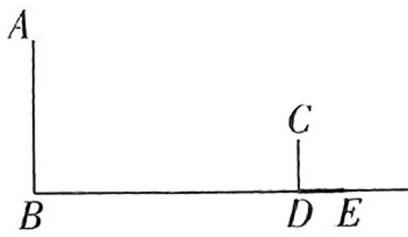

<!-- question-source:start -->
5 小红想利用阳光下的影长测量学校旗杆 $AB$ 的高度. 如图, 某一时刻她在地面上竖立了一根 2 米长的标杆 $CD$ , 测得其影长 $DE = 0.4$ 米. (1) 请在图中画出此时旗杆 $AB$ 在阳光下的投影 $BF$ .

(2) 如果 $BF = 1.6$ 米, 求旗杆 $AB$ 的高.

<!-- question-source:end -->

![[Q00108134A1]]
