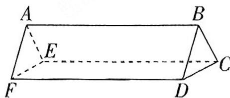

<!-- question-source:start -->
6 如图, 正三棱柱的面 EFDC 平行于投影面 P, 且 AE = EF = AF = 2, AB = 6.

(1)三棱柱在投影平面 $P$ 上的正投影的图形是 \_\_\_\_. A. 一条线段 B. 矩形 C. 平行四边形 D. 等腰梯形

(2)求正投影的面积.

<!-- question-source:end -->

![[Q00108135A1]]
