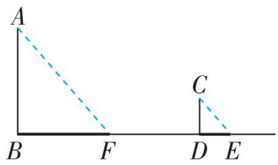

> [!success]- 必刷题
>
> > [!success] **【答案】** 详见解析
>
> > [!note]- **【解析】**
> > 【解】(1)如图,连接 CE, 过点 A 作 $AF \parallel CE$ 交 BD 于点 F, 则 BF 即为所求.
> >
> > 
> >
> > (2) $\because AF \parallel CE, \therefore \angle AFB = \angle CED.$
> >
> > 又∵ $\angle ABF = \angle CDE = 90^{\circ}, \therefore \triangle ABF \sim \triangle CDE,$ $\therefore \frac{AB}{CD} = \frac{BF}{DE}$ , 即 $\frac{AB}{2} = \frac{1.6}{0.4}, \therefore AB = 8$ 米.
> >
> > 答:旗杆 AB 的高为 8 米.
