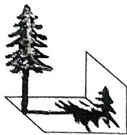

## 课时 2 平行投影 刷基础

## 刷基础

## 知识点 1 平行投影

![[初中/课堂同步/教辅/必刷题/2026《初中必刷题》数学北师9上/05_第五章_投影与视图/课时_2_平行投影/questions/Q00108130.md]]

## 知识点 2 太阳光下影子的变化规律

![[初中/课堂同步/教辅/必刷题/2026《初中必刷题》数学北师9上/05_第五章_投影与视图/课时_2_平行投影/questions/Q00108131.md]]

## 知识点 3 与平行投影有关的计算与应用

![[初中/课堂同步/教辅/必刷题/2026《初中必刷题》数学北师9上/05_第五章_投影与视图/课时_2_平行投影/questions/Q00108132.md]]
![[初中/课堂同步/教辅/必刷题/2026《初中必刷题》数学北师9上/05_第五章_投影与视图/课时_2_平行投影/questions/Q00108133.md]]
![[初中/课堂同步/教辅/必刷题/2026《初中必刷题》数学北师9上/05_第五章_投影与视图/课时_2_平行投影/questions/Q00108134.md]]

## 知识点 4 正投影

![[初中/课堂同步/教辅/必刷题/2026《初中必刷题》数学北师9上/05_第五章_投影与视图/课时_2_平行投影/questions/Q00108135.md]]

## 易错点 对弯折的影子理解不清而致错

数学兴趣小组想测量一棵树的高度,在阳光下,一名同学测得一根长为1米的竹竿的影长

为 0.8 米, 另一名同学测量这棵树的高度时, 发现树的影子不全落在地面上, 有一部分影子落在教学楼的墙壁上 (如

图), 其墙壁上的影长为 1.2 米, 落在地面上的影长为 2.4 米, 则树高为 \_\_\_\_ 米.

电子错题本鸭
