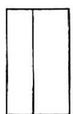
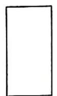
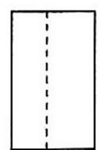
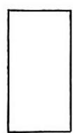
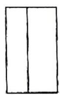
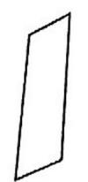
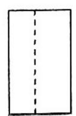
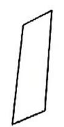
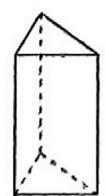
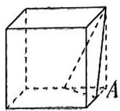

<!-- question-source:start -->
3 如图所示是一个三棱柱,它的主视图和左视图均正确的是 ( )

主视图

左视图

主视图

左视图

A

主视图
左视图

B

主视图

左视图

C

(第3题图)

D

(第4题图)
<!-- question-source:end -->

![[Q00108149A1]]

![[Q00108149A2]]
