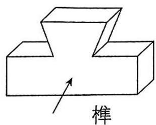
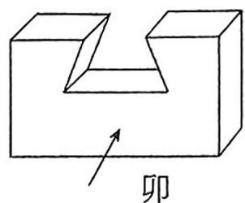

<!-- question-source:start -->
5 新考向传统文化 [2025 安徽阜阳质检] 榫卯是在两个构件上采用凹凸部位相结合的一种连接方式, 体现出中国古老的文化和智慧. 如图是某种榫卯构件的示意图, 则它们的 ( )

正面

正面

A. 主视图一样
B. 左视图一样
C. 俯视图一样
D. 三视图都不一样
<!-- question-source:end -->

![[Q00108151A1]]
