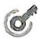
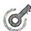

## 课时 2 直棱柱的三视图 刷基础

## 刷基础

## 知识点 1 直棱柱的三视图

![[初中/课堂同步/教辅/必刷题/2026《初中必刷题》数学北师9上/05_第五章_投影与视图/课时_2_直棱柱的三视图/questions/Q00108147.md]]
![[初中/课堂同步/教辅/必刷题/2026《初中必刷题》数学北师9上/05_第五章_投影与视图/课时_2_直棱柱的三视图/questions/Q00108148.md]]
![[初中/课堂同步/教辅/必刷题/2026《初中必刷题》数学北师9上/05_第五章_投影与视图/课时_2_直棱柱的三视图/questions/Q00108149.md]]
![[初中/课堂同步/教辅/必刷题/2026《初中必刷题》数学北师9上/05_第五章_投影与视图/课时_2_直棱柱的三视图/questions/Q00108150.md]]
![[初中/课堂同步/教辅/必刷题/2026《初中必刷题》数学北师9上/05_第五章_投影与视图/课时_2_直棱柱的三视图/questions/Q00108151.md]]
![[初中/课堂同步/教辅/必刷题/2026《初中必刷题》数学北师9上/05_第五章_投影与视图/课时_2_直棱柱的三视图/questions/Q00108152.md]]

## 知识点 2 直棱柱的三视图的画法

![[初中/课堂同步/教辅/必刷题/2026《初中必刷题》数学北师9上/05_第五章_投影与视图/课时_2_直棱柱的三视图/questions/Q00108153.md]]
![[初中/课堂同步/教辅/必刷题/2026《初中必刷题》数学北师9上/05_第五章_投影与视图/课时_2_直棱柱的三视图/questions/Q00108154.md]]
