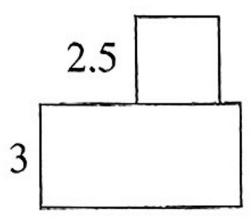
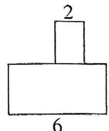
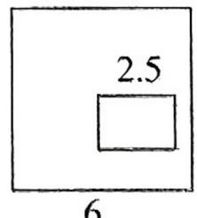
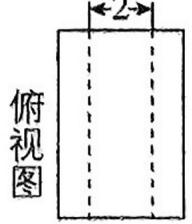

<!-- question-source:start -->
7 [2025 山西运城校级质检]已知一个模型的三视图如图所示.(单位:m)

(1)请描述这个模型的形状.

(2)若制作这个模型的木料密度为 $360 \, kg/m^{3}$ ，则这个模型的质量是多少千克？

(3)若要给这个模型的表面刷油漆,每千克油漆可以刷 $4 \mathrm{~m}^{2}$ ,则需要油漆多少千克?

主视图

左视图

俯视图

是个新“烤”鸭
电子错题本鸭
<!-- question-source:end -->

![[Q00108161A1]]
