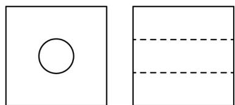

> [!success]- 必刷题
>
> > [!success] **【答案】** 详见解析
>
> > [!note]- **【解析】**
> > 【解】(1)此模型由两个长方体组成:上面是小长方体(长、宽、高分别为2.5 m, 2 m, 2.5 m),下面是大长方体(长、宽、高分别为6 m, 6 m, 3 m).
> >
> > 
> >
> > (2) 模型的体积为 $6 \times 6 \times 3 + 2.5 \times 2 \times 2.5 = 120.5(\mathrm{~m}^{3})$ , 则模型的质量为 $120.5 \times 360 = 43380(\mathrm{kg})$ .
> >
> > (3)模型的表面积为 $2 \times 2.5 \times 2 + 2.5 \times 2.5 \times 2 + 4 \times 6 \times 3 + 2 \times 6 \times 6 = 166.5(\mathrm{~m}^2)$ , 需要油漆的质量为 $166.5 \div 4 = 41.625(\mathrm{kg})$ .
> >
> > 思路分析
> > 根据题意作出图形,设未知数,然后利用相似三角形的性质列出比例式求解即可.
