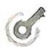
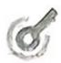

## 课时 3 由三视图判断几何体 刷基础

## 刷基础

## 知识点 1 由三视图判断几何体

![[初中/课堂同步/教辅/必刷题/2026《初中必刷题》数学北师9上/05_第五章_投影与视图/课时_3_由三视图判断几何体/questions/Q00108155.md]]
![[初中/课堂同步/教辅/必刷题/2026《初中必刷题》数学北师9上/05_第五章_投影与视图/课时_3_由三视图判断几何体/questions/Q00108156.md]]
![[初中/课堂同步/教辅/必刷题/2026《初中必刷题》数学北师9上/05_第五章_投影与视图/课时_3_由三视图判断几何体/questions/Q00108157.md]]
![[初中/课堂同步/教辅/必刷题/2026《初中必刷题》数学北师9上/05_第五章_投影与视图/课时_3_由三视图判断几何体/questions/Q00108158.md]]

## 知识点2 三视图的计算

![[初中/课堂同步/教辅/必刷题/2026《初中必刷题》数学北师9上/05_第五章_投影与视图/课时_3_由三视图判断几何体/questions/Q00108159.md]]
![[初中/课堂同步/教辅/必刷题/2026《初中必刷题》数学北师9上/05_第五章_投影与视图/课时_3_由三视图判断几何体/questions/Q00108160.md]]
![[初中/课堂同步/教辅/必刷题/2026《初中必刷题》数学北师9上/05_第五章_投影与视图/课时_3_由三视图判断几何体/questions/Q00108161.md]]
