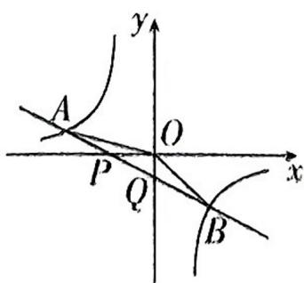

<!-- question-source:start -->
4[2024 山东临沂质检]如图，直线 $y = k_{1}x + b$ 与 $x$ 轴、 $y$ 轴分别交于 $P, Q$ 两点，与 $y = \frac{k_{2}}{x}$ 建议用防 25 分钟 普案 079

的图象相交于 $A(-2, m), B(1, n)$ 两点，连接 $OA, OB$ . 下列结论：① $k_{1} + k_{2} < 0$ ；② 不等式 $k_{1}x + b > \frac{k_{2}}{x}$ 的解集是 $x > -2$ 或 $0 < x < 1$ ；③ $S_{\triangle AOP} = S_{\triangle BOQ}$ ；④ $m + \frac{1}{2}n = 0$ . 其中正确的结论有 \_\_\_\_.（填序号）
<!-- question-source:end -->

![[Q00108207A1]]
