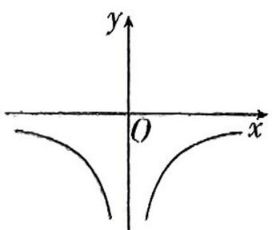
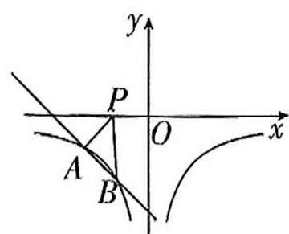

<!-- question-source:start -->
3[2024 四川成都温江区期中,较难]已知在平面直角坐标系 $xOy$ 中,点 $(a,-1),(a-1,-2)$ 在反比例函数 $y=\frac{k}{x}(k\neq0)$ 的图象上.

(2)将反比例函数 $y=\frac{k}{x}$ 的图象中 x 轴上方的部分沿 x 轴翻折, 其余部分保持不变, 得到新的函数图象如图(1)所示, 新函数记为函数 F.

$$
y = - x + b
$$

$$
x _ {2}
$$

$$
x _ {1} <   x _ {2} <   0, x _ {1} = 2 x _ {2}
$$

$$
x _ {1}
$$

$$
A P + B P
$$

图(1)

图(2)
<!-- question-source:end -->

![[Q00108213A1]]
