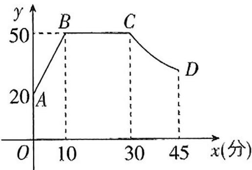

<!-- question-source:start -->
4 [2025 山东济南期中,较难]心理学研究发现,一般情况下,在一节 45 分钟的课上,学生的注意力随学习时间的变化而变化.开始学习时,学生的注意力逐渐增强,中间有一段时间学生的注意力保持较为理想的稳定状态,随后学生的注意力开始分散.经过实验分析可知,学生的注意力指标数 y 随时间 x(分)的变化规律如图所示(其中 AB,BC 分别为线段,CD 为双曲线的一部分;注意力指标数越大说明注意力越集中). (1)分别求出线段 AB 和曲线 CD 的函数表达式. (2)开始学习后第 5 分钟与第 35 分钟,何时学生的注意力更集中? (3)为贯彻“品质课堂”的教育理念,以“立德树人”为根本任务,以“减负增效提质”为目标,立足打造“教有品、学有质、评有效”的品质课堂.某节数学课的学习主要分为三个环节,即“整体感知,明确目标”“探究思考,归纳新知”和“辨别应用,巩固新知”,其中重点环节“探究思考,归纳新知”这一过程至少需要 30 分钟才能完成,为了确保效果,要求这一过程学生的注意力指标数不低于 40.请问这样的要求能否实现?如果能,请给出此环节时间安排的具体方案;如果不能,请说明理由.

电子错题本鸭
<!-- question-source:end -->

![[Q00108214A1]]
