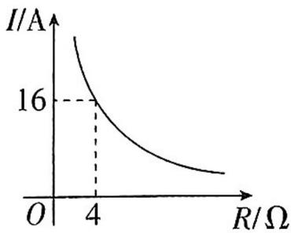
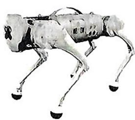

<!-- question-source:start -->
1 [2024 海南中考]某型号蓄电池的电压 $U$ (单位: $\mathrm{V}$ ) 为定值, 使用蓄电池时, 电流 $I$ (单位: $\mathrm{A}$ ) 与电阻 $R$ (单位: $\Omega$ ) 是反比例函数关系, 即 $I = \frac{U}{R}$ , 它的图象如图所示, 则蓄电池的电压 $U$ 为\_\_\_\_(V).

(第1题图)

(第2题图)
<!-- question-source:end -->

![[Q00108304A1]]
