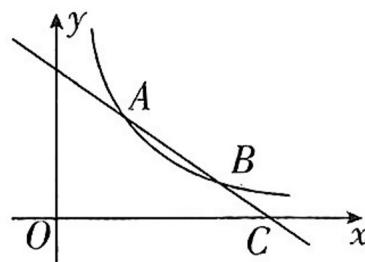

<!-- question-source:start -->
5 如图,一次函数 $y=kx+b(k\neq0)$ 的图象与反比例函数 $y=\frac{m}{x}(m\neq0)$ 在第一象限的图象交于 A(3,4) 和 B 两点,点 B 的纵坐标是 2,一次函数的图象与 x 轴交于点 C.

(1)求一次函数的表达式.

(2)若点 $D$ 在 $\pmb{x}$ 轴上, 且 $\triangle ACD$ 的面积为12, 求

点 $D$ 的坐标.

<!-- question-source:end -->

![[Q00108307A1]]
